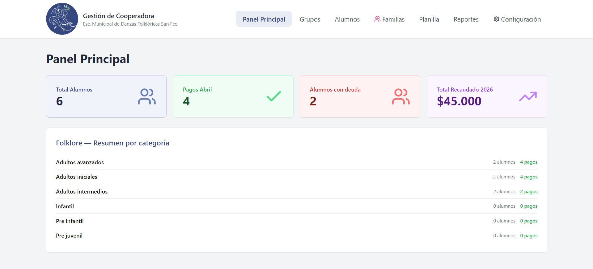
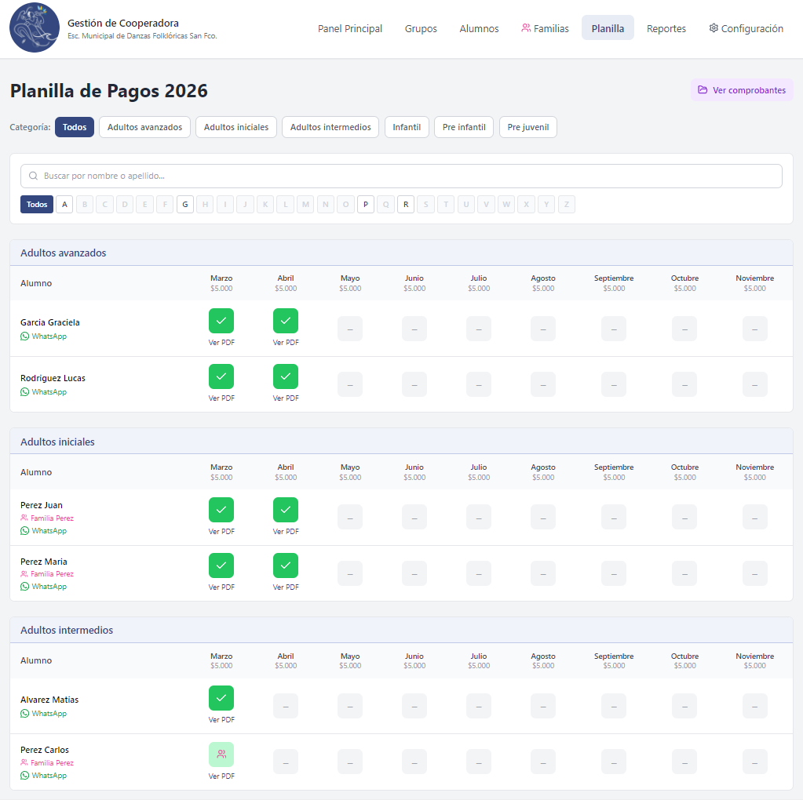
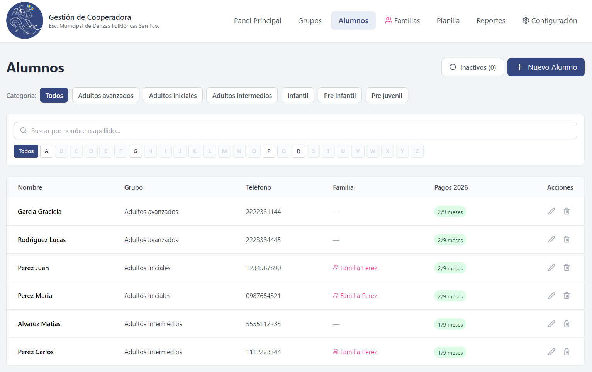
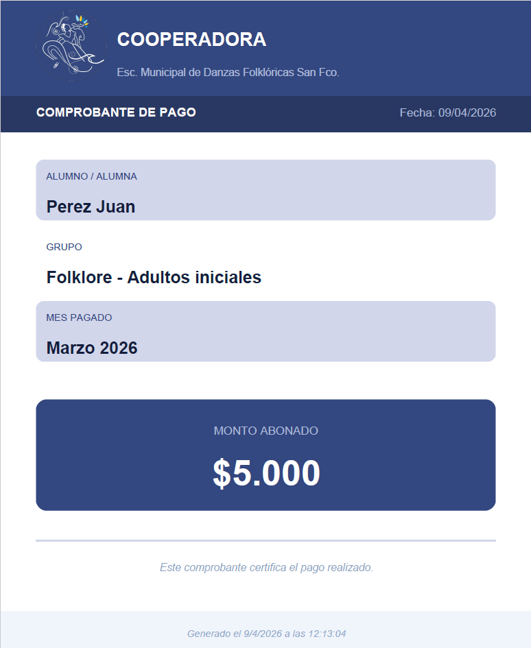

# Gestión de Cooperadora

Sistema de escritorio para la gestión de pagos de cooperadoras escolares. Desarrollado para la **Escuela Municipal de Danzas Folklóricas de San Francisco, Córdoba**, y diseñado para ser reutilizable en otras instituciones.

---

## Capturas

| Dashboard | Planilla de pagos |
|-----------|------------------|
|  |  |

| Alumnos | Comprobante PDF |
|---------|----------------|
|  |  |

---

## Características

- **Gestión de alumnos** — alta, edición, desactivación y reactivación, con búsqueda por nombre y filtro por inicial
- **Grupos y categorías** — organización de alumnos por grupos (Pre infantil, Infantil, Adultos, etc.)
- **Grupos familiares** — descuento automático: cuando una familia tiene 3 o más miembros inscriptos, el tercero (y siguientes) se bonifican automáticamente al registrar el pago
- **Planilla de pagos** — registro mensual con generación automática de comprobante PDF al marcar cada pago
- **Comprobantes PDF** — se guardan organizados por categoría, año y mes junto al ejecutable instalado
- **Reportes** — balance mensual de recaudación y listado de alumnos con deuda
- **Configuración de montos** — cuota configurable por mes y año
- **Integración con WhatsApp** — botón directo para contactar al alumno desde la planilla
- **Funciona 100% offline** — sin servidores ni dependencia de internet

---

## Stack tecnológico

| Tecnología | Uso |
|------------|-----|
| [Electron](https://www.electronjs.org/) v33 | Shell de escritorio (Windows) |
| [React](https://react.dev/) + [TypeScript](https://www.typescriptlang.org/) | Interfaz de usuario |
| [SQLite](https://www.sqlite.org/) (better-sqlite3) | Base de datos local |
| [Tailwind CSS](https://tailwindcss.com/) v3 | Estilos |
| [Vite](https://vitejs.dev/) | Bundler y dev server |
| [electron-builder](https://www.electron.build/) | Empaquetado e instalador |

---

## Estructura del proyecto

```
frontend/
├── electron/
│   ├── database/
│   │   ├── db.ts          # Conexión y ciclo de vida de la BD
│   │   └── schema.ts      # Creación de tablas y migraciones
│   ├── pdf/
│   │   └── generator.ts   # Generación de comprobantes PDF
│   ├── main.ts            # Proceso principal de Electron + IPC handlers
│   └── preload.ts         # Bridge entre Electron y React
└── src/
    ├── components/
    │   ├── layout/
    │   │   └── Navbar.tsx
    │   └── ui/
    │       ├── CampoError.tsx
    │       ├── FiltrosBusqueda.tsx
    │       ├── ModalConfirm.tsx
    │       └── ToastContainer.tsx
    ├── hooks/
    │   └── useApp.ts      # Estado global y lógica compartida
    ├── utils/
    │   └── validaciones.ts
    ├── views/
    │   ├── Configuracion.tsx
    │   ├── Dashboard.tsx
    │   ├── Planilla.tsx
    │   ├── Reportes.tsx
    │   ├── VistaAlumnos.tsx
    │   ├── VistaFamilias.tsx
    │   └── VistaGrupos.tsx
    ├── App.tsx
    ├── electron.d.ts
    ├── main.tsx
    └── types.ts
```

---

## Requisitos

- [Node.js](https://nodejs.org/) v24 o superior
- Windows 10 o superior (el empaquetado está configurado para Windows)

---

## Instalación y desarrollo

```bash
# 1. Clonar el repositorio
git clone https://github.com/gastong99/gestion-cooperadora.git
cd gestion-cooperadora/frontend

# 2. Instalar dependencias
npm install

# 3. Correr en modo desarrollo
npm run dev
```

> En modo desarrollo se abre automáticamente el DevTools de Electron.

---

## Compilación

Para generar el instalador `.exe`:

```powershell
cd "frontend"
$env:CSC_IDENTITY_AUTO_DISCOVERY="false"; npm run electron:build
```

El instalador queda en la carpeta `release/`.

---

## Base de datos

La base de datos SQLite se crea automáticamente en la primera ejecución:

```
C:\Users\[usuario]\AppData\Roaming\Gestión de Cooperadora\cooperadora.db
```

Los comprobantes PDF se guardan junto al ejecutable instalado:

```
[directorio de instalación]\Comprobantes\[Categoría]\[Año]\[Mes]\
```

---

## Tablas principales

| Tabla | Descripción |
|-------|-------------|
| `grupos` | Categorías de alumnos |
| `familias` | Grupos familiares para descuentos |
| `alumnos` | Registro de alumnos (activos e inactivos) |
| `pagos` | Historial de pagos con número de comprobante |
| `configuracion_montos` | Monto de cuota por mes y año |
| `configuracion` | Parámetros generales del sistema |

---

## Autor

**Gastón Galotto** — Técnico en Programación  
[LinkedIn](https://www.linkedin.com/in/gastongalotto/) · [GitHub](https://github.com/gastong99)

---

## Licencia

Este proyecto fue desarrollado como software a medida para uso institucional.
